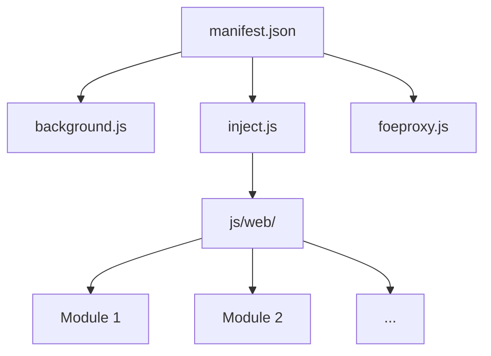

# Plan type — Spécification Technique (STD) pour FoE Helper

*Modèle adapté pour les extensions navigateur (Chrome Manifest V3 / Firefox)*
*Inspiré de DataALC, Le Cours Gratuit, et adapté au contexte FoE Helper*
*Projet : FoE Helper (foe-helfer-extension)*

---

## 📋 Table des matières

1. [Identification du document](#1-identification-du-document)
2. [Contexte et objectifs](#2-contexte-et-objectifs)
3. [Découpage technique](#3-découpage-technique)
4. [Modèle de stockage client (IndexedDB)](#4-modèle-de-stockage-client-indexeddb)
5. [Description des traitements](#5-description-des-traitements)
6. [Interfaces techniques](#6-interfaces-techniques)
7. [Gestion des erreurs techniques](#7-gestion-des-erreurs-techniques)
8. [Performance et dimensionnement](#8-performance-et-dimensionnement)
9. [Sécurité applicative](#9-sécurité-applicative)
10. [Exigences non fonctionnelles et contraintes](#10-exigences-non-fonctionnelles-et-contraintes)
11. [Tests attendus](#11-tests-attendus)
12. [Packaging et distribution](#12-packaging-et-distribution)
13. [Critères de validation](#13-critères-de-validation)
14. [Traçabilité](#14-traçabilité)
15. [Architecture de l'extension](#15-architecture-de-lextension)
16. [Internationalisation (i18n)](#16-internationalisation-i18n)
17. [Gestion des dépendances](#17-gestion-des-dépendances)

---

---

## 1. Identification du document

- **Titre** : STD – [Nom du composant/module]
- **Identifiant** : STD-FOE-[MODULE]-[VERSION] (ex: STD-FOE-CORE-V1.0)
- **Version** : 1.0
- **Statut** : Brouillon / En relecture / Validé / Obsolète
- **Date de création** : AAAA-MM-JJ
- **Dernière mise à jour** : AAAA-MM-JJ

### Historique des versions

| Version | Date | Auteur | Nature de la modification |
|---------|------|--------|----------------------------|
| 1.0 | AAAA-MM-JJ | [Nom] | Création initiale |

### Équipes

- **Auteur·e·s** : [Liste des contributeurs]
- **Relecteur·rice·s** : [À désigner]
- **Valideur·e·s** : [À désigner]
- **Destinataires** : Développeurs FoE Helper, mainteneurs, contributeurs open source

### Rattachement

- **Spécifications fonctionnelles** : Lien vers SFD si applicable
- **Dossier d'architecture** : Lien vers `.01_Memoire/reference/architecture.md`
- **Document parent** : Lien vers STD globale si ce document est un module

---

## 2. Contexte et objectifs

### 2.1 Contexte général

- **Projet** : FoE Helper – Extension navigateur pour Forge of Empires
- **Type** : Extension Chrome Manifest V3 / Firefox (avec polyfills)
- **Licence** : AGPLv3
- **Public cible** : Joueurs de Forge of Empires, développeurs contributeurs
- **Objectif global** : Améliorer l'expérience de jeu sans triche, uniquement des outils d'assistance légale

### 2.2 Objectifs spécifiques du composant

- **Fonctionnalité principale** : [Décrivez en une phrase]
- **Bénéfices** : [Avantages pour l'utilisateur]
- **Impact** : [Impact sur l'expérience de jeu]

### 2.3 Parties prenantes

| Rôle | Acteur | Responsabilités |
|------|--------|-----------------|
| Mainteneur | [Nom] | Validation des modifications |
| Développeurs | Contributeurs open source | Implémentation, tests |
| Utilisateurs | Joueurs de FoE | Feedback, bug reports |
| Communauté | Discord, GitHub | Support, discussions |

### 2.4 Périmètre

- **Inclus** : [Liste des fonctionnalités couvertes par ce composant]
- **Exclus** : [Fonctionnalités hors scope avec justification]
- **Dépendances** : [Modules ou bibliothèques requis]

### 2.5 Définitions et acronymes

| Terme | Définition |
|-------|------------|
| FoE | Forge of Empires (jeu InnoGames) |
| MV3 | Manifest V3 (standard Chrome extensions) |
| CSP | Content Security Policy |
| i18n | Internationalisation |
| DOM | Document Object Model |

### 2.6 Références

- **Documentation officielle** : https://docs.foe-helper.com/
- **Dépôt GitHub** : https://github.com/mainIine/foe-helfer-extension
- **Chrome Extension Docs** : https://developer.chrome.com/docs/extensions/
- **Firefox WebExtensions** : https://extensionworkshop.com/

---

## 3. Découpage technique

### 3.1 Architecture globale du composant

- **Type** : [Service Worker / Content Script / Module UI / Utilitaire]
- **Fichiers principaux** : [Liste des fichiers JS/HTML/CSS]
- **Emplacement** : [Chemin dans la structure du projet]

### 3.2 Schéma des composants

```
[Diagramme ASCII ou description textuelle]

Exemple pour un module typique :
┌─────────────────────────────────────────┐
│              Module X                     │
├─────────────────────────────────────────┤
│  ┌──────────────┐  ┌──────────────────┐ │
│  │   Core       │  │   UI             │ │
│  │  (x.core.js) │  │  (x.ui.js)       │ │
│  └──────────────┘  └──────────────────┘ │
│         │                 │                │
│  ┌──────────────┐  ┌──────────────────┐ │
│  │  Helpers     │  │   CSS            │ │
│  │ (x.helper.js)│  │  (x.css)         │ │
│  └──────────────┘  └──────────────────┘ │
└─────────────────────────────────────────┘
```

### 3.3 Responsabilités des composants

| Composant | Fichier | Responsabilité |
|-----------|---------|----------------|
| [Nom] | [fichier.js] | [Description en une phrase] |

### 3.4 Composants réutilisés

- **Bibliothèques tierces** : [Liste des dépendances dans vendor/]
- **Modules existants** : [Liste des modules FoE Helper réutilisés]
- **Code partagé** : [Fichiers dans js/web/_helper/]

---

## 4. Modèle de stockage client (IndexedDB)

### 4.1 Aperçu général

- **Technologie** : IndexedDB (via Dexie.js wrapper)
- **Wrapper** : Dexie.js [version utilisée]
- **Fichier de configuration** : [Chemin si applicable]

### 4.2 Stores (Object Stores)

| Store | Description | Clé primaire | Index |
|-------|-------------|--------------|-------|
| [nom] | [Description] | [ Champ ] | [index1, index2] |

### 4.3 Schéma détaillé par store

#### Store : [nom]

- **Description** : [À quoi sert ce store]
- **Structure** :
  ```javascript
  {
    champ1: { type: 'string', required: true },
    champ2: { type: 'number', default: 0 },
    champ3: { type: 'array', items: 'object' }
  }
  ```
- **Index** :
  - `index1` : Utilisé pour [requêtes de type X]
  - `index2` : Utilisé pour [requêtes de type Y]
- **Exemple de données** : [JSON d'exemple]

### 4.4 Opérations fréquentes

| Opération | Store | Méthode | Fréquence |
|-----------|-------|---------|-----------|
| [Nom] | [store] | `get()`/`put()`/`where()` | [Haute/Moyenne/Basse] |

### 4.5 Volumétrie et stratégie de purge

- **Taille estimée par utilisateur** : [X Ko/Mo]
- **Croissance attendue** : [Par jour/semaine/mois]
- **Stratégie de nettoyage** : [Automatique/Manuel, critères]
- **Impact de la désinstallation** : Les données sont [supprimées/conservées]

---

## 5. Description des traitements

### 5.1 Flux principaux

#### Flux : [Nom du flux]

```
1. [Étape 1] → [Description]
2. [Étape 2] → [Description]
3. [Étape 3] → [Description]
```

### 5.2 Pseudo-code des algorithmes complexes

```javascript
// Exemple : Calcul des points de forge
function calculerPointsForge(batiments, bonus) {
  // Algorithme ici
  let total = 0;
  batiments.forEach(b => {
    total += b.points * (1 + bonus);
  });
  return total;
}
```

### 5.3 Transactions et atomicité

- **Périmètre transactionnel** : [Quelles opérations sont groupées]
- **Points de validation** : [Quand la transaction est validée]
- **Points d'annulation** : [Quand la transaction est annulée]
- **Rollback** : [Mécanisme de retour arrière]

### 5.4 Idempotence

- **Traitement idempotent** : [Oui/Non]
- **Justification** : [Pourquoi/Pourquoi pas]
- **Conséquences d'un double appel** : [Aucun/Erreur/Doublon]

### 5.5 Parallélisme et concurrence

- **Exécution parallèle** : [Oui/Non, dans quels cas]
- **Verrouillage** : [Mécanisme utilisé si applicable]
- **Gestion des conflits** : [Comment les conflits sont résolus]
- **Problèmes de concurrence identifiés** : [Liste]

---

## 6. Interfaces techniques

### 6.1 Interfaces avec le jeu Forge of Empires

#### 6.1.1 Manipulation du DOM

- **Points d'injection** : [Où le code est injecté dans la page FoE]
  - Ex: `#game-container`, `.city-view`, etc.
- **Éléments créés** : [Liste des éléments HTML/CSS ajoutés]
- **Styles appliqués** : [Classes CSS, fichiers CSS utilisés]

#### 6.1.2 Écoute des événements

| Événement | Élément | Action déclenchée |
|-----------|---------|------------------|
| `click` | `.button-class` | [Description] |
| `load` | `window` | [Initialisation] |
| `custom:event` | `document` | [Gestion événement FoE] |

#### 6.1.3 Extraction de données

- **Méthodes** : [Comment les données sont extraites du DOM]
  - Ex: `document.querySelector('.resource-value').textContent`
- **Fréquence** : [Périodique/À la demande/Événementiel]
- **Format des données** : [JSON, objets JS, etc.]

#### 6.1.4 Appels API (si applicable)

- **Endpoints utilisés** : [Liste des URLs si reverse engineering]
- **Méthodes** : [GET/POST/PUT/DELETE]
- **Headers** : [Headers requis]
- **Payload** : [Structure des données envoyées]
- **Réponse** : [Structure des données reçues]

### 6.2 Interfaces avec Chrome Extension API

#### 6.2.1 Storage

- **Type** : `chrome.storage.local` / `chrome.storage.sync`
- **Utilisation** : [Pour quelles données]
- **Limites** : [Quotas, restrictions]

#### 6.2.2 Alarms

- **Alarmes définies** : [Liste des alarms avec leur fréquence]
- **Actions déclenchées** : [Ce qui se passe quand l'alarme sonne]

#### 6.2.3 Tabs

- **Utilisation** : [Accès aux onglets, injection de scripts]
- **Permissions** : [`activeTab`, `tabs`, etc.]

#### 6.2.4 Runtime

- **Message Passing** : Communication entre :
  - background.js ↔ content scripts
  - content scripts ↔ popup
- **Types de messages** : [Liste des messages échangés]

#### 6.2.5 i18n

- **Utilisation** : `chrome.i18n.getMessage()`
- **Fichiers** : `_locales/[lang]/messages.json`

### 6.3 Communication interne

#### 6.3.1 Échanges entre modules

- **Mécanisme** : [Event bus, fonctions partagées, storage]
- **Protocole** : [Format des messages/événements]

#### 6.3.2 État partagé

- **Variables globales** : [Liste si applicable]
- **Storage partagé** : [Données accessibles par plusieurs modules]

---

## 7. Gestion des erreurs techniques

### 7.1 Erreurs prévues et leur traitement

| Erreur | Cause | Détection | Traitement | Logging |
|--------|-------|-----------|------------|---------|
| [Nom] | [Pourquoi ça arrive] | [Comment on la détecte] | [Que fait-on] | [Où est loggé] |

### 7.2 Politique de reprise

- **Nombre de tentatives** : [Par défaut]
- **Temporisation** : [Délai entre les tentatives]
- **Abandon** : [Après combien d'essais on abandonne]
- **Notification utilisateur** : [Oui/Non, comment]

### 7.3 Journalisation (Logging)

- **Niveaux** : [ERROR, WARN, INFO, DEBUG]
- **Format** : [Structure des logs]
- **Destination** : [console.log, storage, etc.]
- **Exclusions** : [Données sensibles à ne pas logger]
  - ❌ Ne jamais logger : tokens, mots de passe, données personnelles

### 7.4 Remontée vers la supervision

- **Mécanisme** : [Comment les erreurs critiques sont remontées]
- **Alertes** : [Si applicable, comment]

---

## 8. Performance et dimensionnement

### 8.1 Temps de traitement cible

- **Opérations critiques** : [Liste avec temps cible]
  - Ex: Chargement initial < 500ms
  - Ex: Calcul des stats < 100ms
- **Mesure** : [Comment la performance est mesurée]

### 8.2 Consommation mémoire

- **Mémoire estimée** : [Par module/Par fonctionnalité]
- **Fuite mémoire** : [Risques identifiés et préventions]
- **Optimisations** : [Techniques utilisées]

### 8.3 Traitement par lots

- **Batching** : [Quand les opérations sont groupées]
- **Taille des lots** : [Nombre d'éléments par batch]
- **Impact performance** : [Gains attendus]

### 8.4 Points sensibles identifiés

| Point sensible | Impact | Parade retenue |
|---------------|--------|-----------------|
| [Nom] | [Conséquence] | [Solution implémentée] |

---

## 9. Sécurité applicative

### 9.1 Permissions (manifest.json)

| Permission | Justification | Risque | Mitigation |
|------------|---------------|--------|------------|
| `storage` | Sauvegarde des settings utilisateur | Accès aux données locales | Limité aux données FoE Helper |
| `alarms` | Notifications périodiques | Exécution de code en arrière-plan | Alarmes définies par l'utilisateur |
| `activeTab` | Accès à l'onglet FoE | Accès au DOM de la page | Limité à l'onglet actif |
| [Autres] | [Justification] | [Risque] | [Mitigation] |

### 9.2 Content Security Policy (CSP)

- **CSP dans manifest.json** :
  ```json
  "content_security_policy": "[votre CSP ici]"
  ```
- **Sources autorisées** : [Liste des sources]
- **Restrictions** : [Ce qui est bloqué]
- **Impact sur le développement** : [Comment le CSP affecte le code]
- **Exceptions** : [Cas où le CSP doit être assoupli]

### 9.3 Injection de code

- **Sécurité DOM** : [Prévention des XSS]
  - ✅ Toujours utiliser `textContent` au lieu de `innerHTML` quand possible
  - ✅ Sanitizer les inputs utilisateur
  - ✅ Échapper les données avant affichage
- **Sanitization** : [Bibliothèques/méthodes utilisées]
- **Isolation** : [Utilisation de shadow DOM, iframes]

### 9.4 Données utilisateur

- **Collecte** : ❌ Aucune donnée personnelle collectée
- **Stockage** : ✅ Données locales uniquement (IndexedDB, chrome.storage)
- **Partage** : ❌ Aucune transmission à des serveurs tiers
- **Conformité RGPD** : ✅ Respect des réglementations

### 9.5 Gestion des secrets

- **Secrets utilisés** : [Liste si applicable, ex: clés API]
- **Mode d'accès** : [Comment ils sont chargés]
- **⚠️ NE JAMAIS** : [Stocker des secrets en dur dans le code]

---

## 10. Exigences non fonctionnelles et contraintes

### 10.1 Contraintes réglementaires

- **Licence** : AGPLv3 – Respect des obligations de distribution
- **Droits d'auteur** : Copyright FoE-Helper team
- **Utilisation** : Interdit pour la triche, uniquement assistance légale

### 10.2 Contraintes techniques

- **Navigateurs supportés** : Chrome, Edge, Brave, Opera, Firefox
- **Manifest** : V3 (avec polyfills pour Firefox)
- **ES Version** : ES5/ES6 (compatible tous navigateurs modernes)
- **Pas de build** : Code utilisé directement sans bundler

### 10.3 Contraintes d'exploitation

- **Environnement** : Exécution dans le contexte du navigateur
- **Ressources** : Limitées par les quotas du navigateur
- **Connectivité** : Dépend de la connexion internet pour FoE

### 10.4 Normes et protocoles

- **Chrome Extension API** : Respect des bonnes pratiques
- **Web Standards** : HTML5, CSS3, JavaScript moderne
- **Accessibilité** : [Si applicable]

---

## 11. Tests attendus

### 11.1 Stratégie de test

- **Type** : Tests manuels (pas de framework automatisé)
- **Environnement** : Chrome, Edge, Firefox
- **Fréquence** : Après chaque modification, avant chaque commit/PR
- **Responsable** : Développeur, puis relecteur

### 11.2 Cas de test

#### 11.2.1 Cas nominaux

| ID | Description | Étapes | Résultat attendu |
|----|-------------|--------|------------------|
| TC-N-001 | [Nom] | 1. [Action 1] 2. [Action 2] | [Résultat] |

#### 11.2.2 Cas limites

| ID | Description | Condition | Résultat attendu |
|----|-------------|-----------|------------------|
| TC-L-001 | [Nom] | [Condition limite] | [Résultat] |

#### 11.2.3 Cas d'erreur

| ID | Description | Erreur simulée | Comportement attendu |
|----|-------------|----------------|----------------------|
| TC-E-001 | [Nom] | [Comment provoquer] | [Gestion de l'erreur] |

### 11.3 Procédures de test

#### Prérequis
- Extension chargée dans le navigateur
- Jeu Forge of Empires ouvert
- Compte utilisateur connecté
- Console navigateur ouverte

#### Étapes types
1. Ouvrir le jeu FoE
2. Activer la fonctionnalité à tester
3. Vérifier le comportement visuel
4. Vérifier les logs dans la console (`console.log`, `console.error`)
5. Vérifier le stockage (`chrome.storage.local.get()`)

### 11.4 Outils de test

- **Console navigateur** : Chrome DevTools / Firefox Developer Tools
- **Storage Inspector** : Vérification des données sauvegardées
- **Network Tab** : Surveillance des requêtes (si applicable)

---

## 12. Packaging et distribution

### 12.1 Livrables

| Type | Fichiers/Répertoires | Obligatoire | Description |
|------|---------------------|-------------|-------------|
| Manifest | `manifest.json` | ✅ | Configuration de l'extension |
| Background | `background.js` | ✅ | Service Worker |
| Injection | `inject.js`, `foeproxy.js` | ✅ | Content Scripts |
| Modules | `js/web/` | ✅ | Tous les modules fonctionnels |
| UI | `content/`, `css/` | ✅ | Interface utilisateur |
| Ressources | `images/`, `_locales/` | ✅ | Assets et traductions |
| Dépendances | `vendor/` | ✅ | Bibliothèques tierces |
| Documentation | `.02_Docs/`, `AGENTS.md` | ❌ | Optionnel mais recommandé |

### 12.2 Packaging

- **Format** : Archive ZIP
- **Commande** :
  ```bash
  # Sous Windows
  powershell Compress-Archive -Path * -DestinationPath foe-helper-vX.Y.Z.zip -Exclude @('.git*', '.vscode*', '*.md')
  
  # Sous Linux/Mac
  zip -r foe-helper-vX.Y.Z.zip * -x '.git*' '.vscode*' '*.md'
  ```
- **Exclusions** : `.git/`, `.vscode/`, `node_modules/`, fichiers de documentation

### 12.3 Installation

#### Chrome / Edge / Brave / Opera
1. Ouvrir `chrome://extensions/`
2. Activer le mode **Développeur**
3. Cliquer sur **Charger l'extension non empaquetée**
4. Sélectionner le répertoire du projet

#### Firefox
1. Ouvrir `about:debugging`
2. Cliquer sur **Ce Firefox** (à gauche)
3. Cliquer sur **Charger un module complémentaire temporaire**
4. Sélectionner le fichier `manifest.json`

### 12.4 Versionnement

- **Fichier** : `manifest.json` (champ `"version"`)
- **Format** : `MAJOR.MINOR.PATCH` (ex: `2.15.3`)
- **Règles** :
  - MAJOR : Changements incompatibles (breaking changes)
  - MINOR : Nouveautés compatibles
  - PATCH : Corrections de bugs
- **Changelog** : Mise à jour de `changelog-en.md` et `changelog-de.md`

### 12.5 Retour arrière (Rollback)

- **Procédure** :
  1. Désinstaller l'extension
  2. Recharger la version précédente
- **Impact** : Les données utilisateur (settings) sont **conservées** dans IndexedDB
- **Précaution** : Sauvegarder manuellement les settings si nécessaire

---

## 13. Critères de validation

### 13.1 Méthodes de vérification

- **Tests manuels** : Vérification visuelle et fonctionnelle
- **Console** : Absence d'erreurs dans la console
- **Storage** : Données correctement sauvegardées et restaurées
- **Compatibilité** : Fonctionne sur Chrome, Edge, Firefox

### 13.2 Critères mesurables

| Critère | Valeur cible | Méthode de mesure |
|---------|--------------|-------------------|
| Temps de chargement | < 1s | Chronométrage manuel |
| Consommation mémoire | < 50 Mo | Chrome DevTools Memory Tab |
| Taux de couverture | 100% des cas nominaux | Tests manuels exhaustifs |
| Compatibilité navigateurs | Chrome, Edge, Brave, Opera, Firefox | Test sur chaque navigateur |

---

## 14. Traçabilité

### 14.1 Tableau de traçabilité exigences → implémentation

| Exigence (SFD) | Composant | Fichier | Statut |
|---------------|-----------|--------|--------|
| [ID-SFD-001] | [Module] | [fichier.js] | ✅ Implémenté |
| [ID-SFD-002] | [Module] | [fichier.js] | ⚠️ Partiel |

### 14.2 Écarts assumés

| Exigence | Écart | Justification |
|----------|-------|---------------|
| [Exigence] | [Description de l'écart] | [Pourquoi cet écart est acceptable] |

---

## 15. Architecture de l'extension

*Section spécifique aux extensions navigateur*

### 15.1 Manifest V3

- **Fichier** : `manifest.json`
- **Version** : 3
- **Champs clés** :
  ```json
  {
    "manifest_version": 3,
    "name": "FoE Helper",
    "version": "X.Y.Z",
    "description": "...",
    "permissions": [...],
    "background": {
      "service_worker": "background.js"
    },
    "content_scripts": [...],
    "action": {
      "default_popup": "content/popup.html"
    }
  }
  ```

### 15.2 Service Worker (background.js)

- **Rôle** : Gestion des alarmes, stockage global, coordination
- **Cycle de vie** : Chargé au démarrage du navigateur, persiste
- **Fonctionnalités** :
  - Gestion des alarmes (`chrome.alarms`)
  - Stockage centralisé (`chrome.storage`)
  - Communication avec les content scripts

### 15.3 Content Scripts

#### 15.3.1 foeproxy.js
- **Rôle** : Proxy exécuté à `document_start`
- **world** : `MAIN` (accès au DOM du jeu)
- **Fonctionnalités** : Injection des scripts principaux

#### 15.3.2 inject.js
- **Rôle** : Script d'injection principal
- **Fonctionnalités** :
  - Détection du jeu FoE
  - Chargement dynamique des modules
  - Gestion des dépendances entre modules

### 15.4 Chargement dynamique des modules

- **Mécanisme** : Détection des éléments du DOM → chargement des modules pertinents
- **Avantages** :
  - Performance : seul le code nécessaire est chargé
  - Modularité : chaque fonctionnalité est isolée
- **Implémentation** :
  ```javascript
  // Exemple dans inject.js
  if (document.querySelector('.city-view')) {
    loadModule('CityView');
  }
  ```

### 15.5 Compatibilité Firefox

- **Polyfills** : `vendor/browser-polyfill/`
- **Différences** :
  - `browser` vs `chrome` namespace
  - Service Worker vs Background Page
- **Test** : Vérification systématique sur Firefox

---

## 16. Internationalisation (i18n)

*Gestion des traductions pour 9 langues*

### 16.1 Système d'internationalisation

- **API** : Chrome i18n API (`chrome.i18n.getMessage()`)
- **Compatibilité Firefox** : Géré par le polyfill

### 16.2 Structure des fichiers

```
_locales/
├── de/          # Allemand
│   └── messages.json
├── en/          # Anglais
│   └── messages.json
├── fr/          # Français
│   └── messages.json
├── nl/          # Néerlandais
│   └── messages.json
├── pl/          # Polonais
│   └── messages.json
├── ro/          # Roumain
│   └── messages.json
├── ru/          # Russe
│   └── messages.json
└── sv/          # Suédois
    └── messages.json
```

### 16.3 Format des fichiers messages.json

```json
{
  "moduleName": {
    "message": "Traduction"
  },
  "buttonLabel": {
    "message": "Texte du bouton",
    "description": "Description pour les traducteurs"
  }
}
```

### 16.4 Utilisation dans le code

```javascript
// Dans le HTML
<button id="myButton">__MSG_buttonLabel__</button>

// Dans le JS
const message = chrome.i18n.getMessage('moduleName');
```

### 16.5 Ajout d'une nouvelle langue

1. Créer le répertoire `_locales/[code]/` (code = 2 lettres ISO)
2. Copier `messages.json` depuis une langue existante
3. Traduire toutes les chaînes
4. Tester dans le navigateur avec cette langue

---

## 17. Gestion des dépendances

*Aucun gestionnaire de paquets (npm/yarn), dépendances manuelles*

### 17.1 Répertoire des dépendances

- **Emplacement** : `vendor/`
- **Structure** :
  ```
  vendor/
  ├── jquery/          # jQuery 3.x
  ├── bootstrap/      # Bootstrap 4.2.1
  ├── highcharts/      # Highcharts 8.0.4
  ├── dexie/           # Dexie.js (IndexedDB wrapper)
  ├── browser-polyfill/ # Polyfills pour Firefox
  └── ... (20+ bibliothèques)
  ```

### 17.2 Fichier de référence

- **Fichier** : `vendor.json`
- **Contenu** : Liste des dépendances avec version et source

### 17.3 Ajout d'une dépendance

1. Télécharger les fichiers depuis la source officielle
2. Placer dans `vendor/[nom-de-la-bibliotheque]/`
3. Mettre à jour `vendor.json`
4. Tester l'intégration
5. Commiter les modifications

### 17.4 Mise à jour d'une dépendance

1. Vérifier la compatibilité avec le code existant
2. Remplacer les fichiers dans `vendor/`
3. Mettre à jour `vendor.json`
4. Tester toutes les fonctionnalités dépendantes
5. Commiter les modifications

---

## Annexes

### A. Schémas d'architecture

[À inclure : diagrammes Mermaid ou images]



### B. Glossaire

| Terme | Définition |
|-------|------------|
| [Terme] | [Définition] |

### C. Références externes

- [Chrome Extension Documentation](https://developer.chrome.com/docs/extensions/)
- [Firefox WebExtensions](https://extensionworkshop.com/)
- [IndexedDB API](https://developer.mozilla.org/en-US/docs/Web/API/IndexedDB_API)
- [Dexie.js Documentation](https://dexie.org/)

---

## 📝 Notes pour le rédacteur

### Conseils pour la rétro-documentation

1. **Commencez par l'existant** : Analyser le code source avant de documenter
2. **Soyez précis** : Donnez des exemples concrets tirés du code
3. **Restez concis** : Une phrase par responsabilité, des listes pour les énumérations
4. **Utilisez le code** : Extraits de code valent mieux que de longues descriptions
5. **Documentez les décisions** : Pourquoi ce choix plutôt qu'un autre ?
6. **Mettez à jour** : La documentation doit suivre l'évolution du code

### Bonnes pratiques FoE Helper

- **Copyright** : Chaque fichier commence par un bloc de commentaire AGPLv3
- **Internationalisation** : Toujours utiliser `__MSG_` pour les chaînes visibles
- **Modularité** : Chaque fonctionnalité dans son propre répertoire sous `js/web/`
- **Compatibilité** : Tester sur Chrome ET Firefox
- **Performance** : Chargement dynamique pour minimiser l'impact

---

*Ce template est conçu pour être utilisé dans le cadre de la rétro-documentation du projet FoE Helper.*
*Adaptez-le selon les spécificités du composant que vous documentez.*
